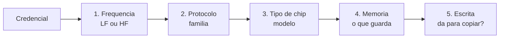

# Guia de Leitura e Identificação de RFID

Material de estudo sobre como ler e identificar cartões, tags, chaveiros e outras
credenciais de rádio-frequência (RFID/NFC). Cobre as faixas LF (baixa frequência,
cerca de 125 kHz) e HF (alta frequência, 13,56 MHz).

A ideia aqui é entender o que é cada credencial, como ela funciona por dentro e
como identificá-la antes de tentar ler, copiar ou escrever. Os capítulos 01 a 08
não citam equipamento nenhum de propósito, para focar no conceito. Os aparelhos
aparecem só no apêndice (09).

## Índice

| # | Capítulo | O que cobre |
|---|---|---|
| 01 | [Fundamentos](docs/01-fundamentos.md) | O que é RFID, acoplamento indutivo, as três camadas da identificação |
| 02 | [Anatomia interna](docs/02-anatomia-interna.md) | Partes internas de tags e leitores, e por que a posição importa |
| 03 | [Baixa Frequência (LF)](docs/03-baixa-frequencia-lf.md) | 125 kHz: EM4100, transponders regraváveis, prox |
| 04 | [Alta Frequência (HF)](docs/04-alta-frequencia-hf.md) | 13,56 MHz, ISO 14443, UID/ATQA/SAK, famílias |
| 05 | [MIFARE Classic](docs/05-mifare-classic.md) | Setores, blocos, trailer, chaves, UID-only |
| 06 | [Cartões Magic](docs/06-cartoes-magic.md) | UID gravável, gerações e por que tags se perdem |
| 07 | [Metodologia de identificação](docs/07-metodologia-identificacao.md) | Fluxograma mestre, passo a passo e checklist |
| 08 | [Erros comuns](docs/08-erros-comuns.md) | Sintoma, causa e saída |
| 09 | [Dispositivos de leitura](docs/09-dispositivos-leitura.md) | Aparelhos que ajudam a ler (apêndice) |

### Consulta rápida

| Página | Para que serve |
|---|---|
| [Referência rápida](docs/referencia-rapida.md) | Tabelas de SAK, frequências, variantes e tamanhos de UID em um lugar só |
| [FAQ](docs/faq.md) | Perguntas diretas da prática, com resposta curta |
| [Glossário](docs/glossario.md) | Todos os termos técnicos do guia |

## Como usar

- Se está começando, leia na ordem, do 01 ao 09.
- Se já tem uma credencial na mão e quer identificar, vá direto ao
  [fluxograma mestre (cap. 07)](docs/07-metodologia-identificacao.md).
- Se travou num erro, consulte o
  [catálogo de erros (cap. 08)](docs/08-erros-comuns.md).
- Para uma consulta de segundos, use a
  [referência rápida](docs/referencia-rapida.md) ou o [FAQ](docs/faq.md).

### As seis regras práticas do guia

1. Se não ler em HF, teste LF antes de desistir.
2. "Não leu" quase sempre é posição. Varie o lugar sobre a antena.
3. Copiar um ID de LF exige um destino regravável.
4. O tamanho do UID (4 ou 7 bytes) do destino tem que casar com o da origem.
5. Dump com tudo em 00 e chaves FF é sistema UID-only (só o UID importa).
6. Depois de gravar, releia o destino e confira.

## Mapa mental

## Uso responsável

Este material é educacional. Identifique, leia ou copie apenas credenciais que são
suas ou para as quais você tem autorização do dono. Clonar credencial de terceiro
sem permissão pode ser crime. O autor não se responsabiliza pelo uso indevido do
que está aqui.

## Licença

[MIT](LICENSE).
