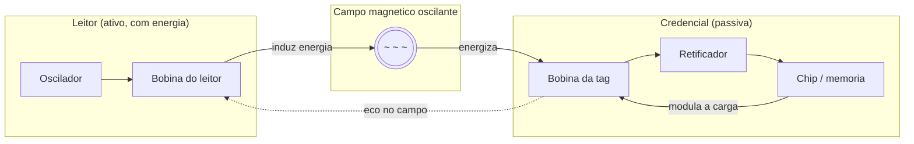
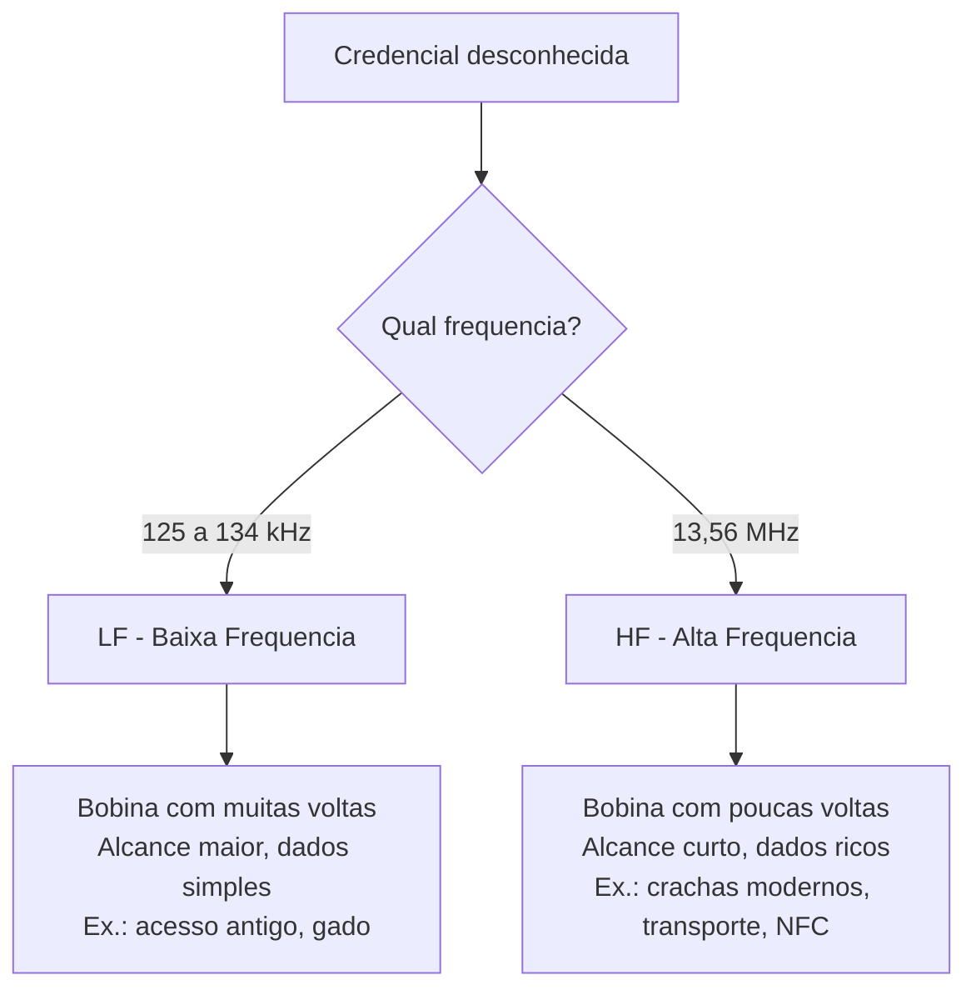
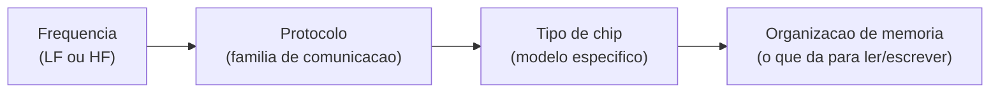

# 01 - Fundamentos: o que é RFID e como funciona

RFID (Radio-Frequency Identification) é um conjunto de tecnologias em que uma
credencial (cartão, tag, chaveiro, adesivo, pulseira) troca dados com um leitor
por ondas de rádio, sem contato e, na maioria das vezes, sem bateria na
credencial.

A pergunta central deste guia é: "tenho uma credencial na mão, como descubro o
que ela é?". Para responder isso com segurança, primeiro é preciso entender três
camadas que definem qualquer credencial RFID:

1. A frequência em que ela opera.
2. O protocolo de comunicação, ou seja, as regras da conversa.
3. O tipo de chip e como a memória dele é organizada.

Identificar uma credencial é, na prática, descer essas três camadas em ordem.

## 1. A credencial não tem bateria, então como ela liga?

A maioria das credenciais RFID é passiva: não tem fonte de energia própria. Ela é
energizada pelo campo do leitor, por um fenômeno chamado acoplamento indutivo.

O leitor tem uma bobina (antena) por onde passa corrente alternada, gerando um
campo magnético que oscila. Quando a bobina da credencial entra nesse campo,
aparece nela uma tensão induzida. É o mesmo princípio de um transformador, só que
sem fio. Essa energia alimenta o chip.

O que tirar desse diagrama:

- O leitor sempre fala primeiro e mantém o campo ligado o tempo todo.
- A credencial aproveita esse campo para se alimentar.
- Para responder, a credencial não gera sinal próprio. Ela varia a própria carga
  (liga e desliga uma resistência), o que causa uma pequena variação no campo que
  o leitor consegue detectar. Isso se chama modulação de carga.

Por que isso importa na identificação: como a energia vem do acoplamento, o
alcance é curto (de milímetros a poucos centímetros) e muito sensível à posição.
Boa parte das falhas de leitura não é incompatibilidade, é só a credencial mal
posicionada sobre a antena.

## 2. A frequência define quase tudo

As credenciais passivas se concentram em duas faixas. A frequência é a primeira
coisa a descobrir, porque ela define a antena, o protocolo e os tipos de chip
possíveis. Uma antena de uma faixa não enxerga a outra.

| Característica | LF (125 kHz) | HF (13,56 MHz) |
|---|---|---|
| Faixa típica | 125 a 134 kHz | 13,56 MHz |
| Antena | Bobina de muitas voltas de fio fino | Espiral de poucas voltas, às vezes impressa |
| Alcance passivo | Alguns cm (maior) | Milímetros a cerca de 10 cm (menor) |
| Volume de dados | Pequeno, em geral só um ID | Grande: setores, arquivos, criptografia |
| Segurança | Em geral baixa ou nenhuma | De nenhuma a forte, depende do chip |
| Uso comum | Acesso legado, rastreio animal, imobilizador | Crachás, transporte, pagamento, NFC |

Regra prática 1: se uma ferramenta não acha nada em HF, teste LF antes de concluir
que a credencial está morta. Muita tag que "não lê" é só de outra faixa.

As faixas e os chips de cada uma estão em:
- [03 - Baixa Frequência (LF)](03-baixa-frequencia-lf.md)
- [04 - Alta Frequência (HF)](04-alta-frequencia-hf.md)

## 3. Protocolo e tipo de chip

Dentro de cada frequência existem vários protocolos (formas padronizadas de o
leitor e a credencial conversarem) e, dentro de cada protocolo, vários tipos de
chip, cada um com sua memória e seu nível de segurança.

O caminho da identificação vai sempre do geral para o específico:

Nos próximos capítulos cada camada é aberta em detalhe. Antes disso, o
[02 - Anatomia interna](02-anatomia-interna.md) mostra como a credencial e o
leitor são por dentro, o que ajuda a entender por que a identificação funciona do
jeito que funciona.

## Resumo do capítulo

- Credencial passiva não tem bateria. É energizada pelo campo do leitor por
  acoplamento indutivo.
- Ela responde por modulação de carga, sem gerar sinal próprio.
- Identificar é descobrir, em ordem: frequência, protocolo, tipo de chip e
  memória.
- Frequência primeiro. LF e HF não se enxergam.

Próximo: [02 - Anatomia interna de tags e leitores](02-anatomia-interna.md)
