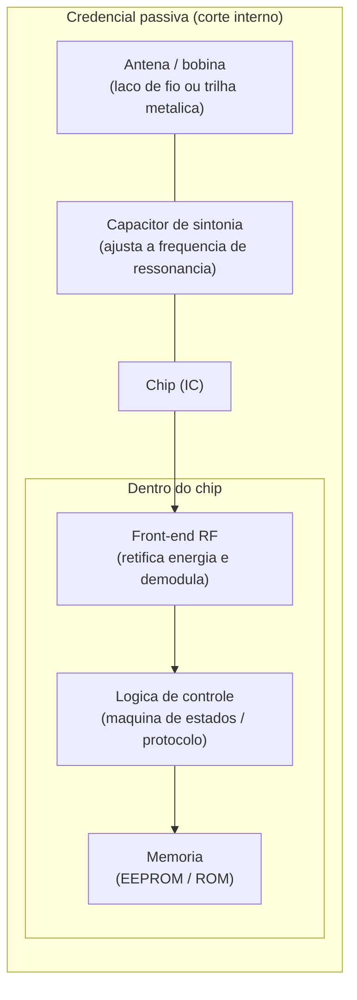
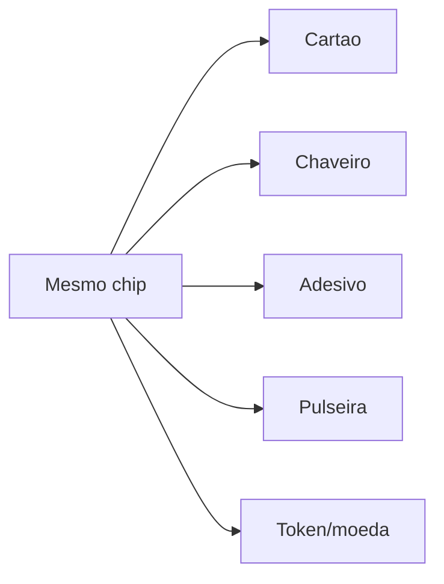
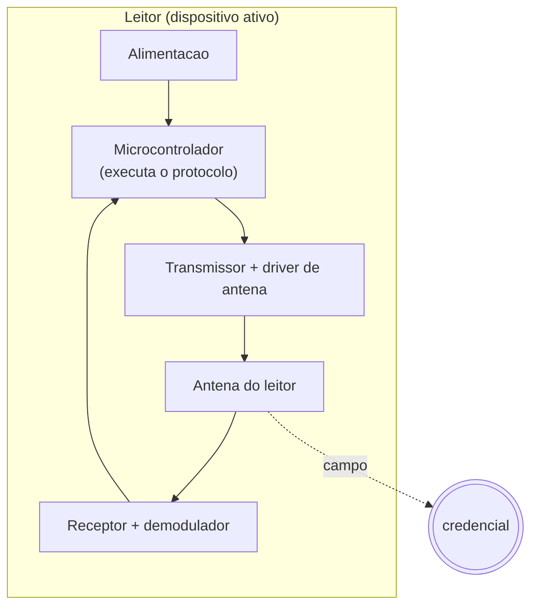
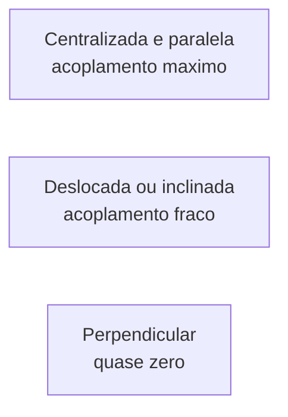
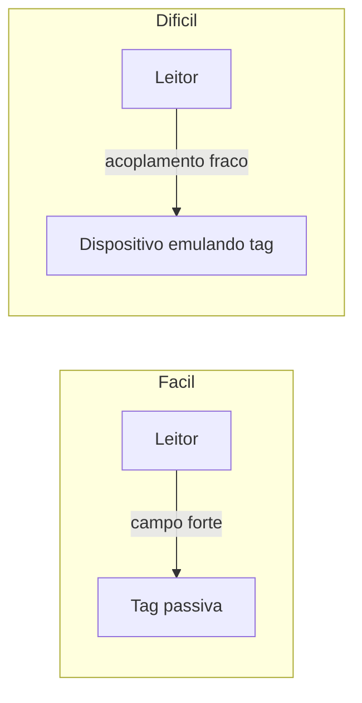

# 02 - Anatomia interna de tags e leitores

Entender o que existe dentro de uma credencial e de um leitor ajuda a interpretar
o que acontece na hora de identificar: por que o alcance é curto, por que a
posição importa tanto e por que uma tag "lê mas não grava".

## 1. Por dentro de uma credencial passiva

Os formatos variam (cartão, chaveiro, adesivo, pulseira, token, implante), mas o
interior é quase sempre o mesmo: uma antena (bobina) ligada a um chip minúsculo,
tudo sobre um substrato e encapsulado.

O que cada parte faz:

- Antena (bobina): capta o campo do leitor (energia) e serve de boca e ouvido da
  comunicação. Em LF tem muitas voltas de fio fino. Em HF, poucas voltas em
  espiral, às vezes impressas em alumínio ou cobre.
- Capacitor de sintonia: junto com a bobina forma um circuito ressonante afinado
  na frequência de operação. Se a sintonia está ruim, o alcance cai. É parte do
  motivo de uma tag ler melhor que outra.
- Front-end RF do chip: retifica a energia induzida (transforma a oscilação em
  tensão contínua para alimentar a lógica) e demodula os comandos que chegam.
- Lógica de controle: a máquina de estados que implementa o protocolo (acordar,
  anticolisão, autenticar, ler, escrever).
- Memória: onde o ID e os dados ficam. Pode ser ROM (só leitura, gravada de
  fábrica), EEPROM (regravável) ou mista.

Na prática: se o chip é de ROM, nenhuma ferramenta grava nele. Não é trava, é a
natureza do silício. Já um chip de EEPROM pode ou não permitir escrita, dependendo
de bits de bloqueio.

### Formato não é função

O formato físico não diz nada sobre o chip. Um chaveiro, um cartão e um adesivo
podem ter exatamente o mesmo chip, e dois chaveiros iguais por fora podem ser de
frequências diferentes. Nunca identifique pela aparência. Só a leitura revela o
que há dentro.

## 2. Por dentro de um leitor

O leitor é o lado ativo: tem energia, gera o campo e comanda a conversa.

- Antena do leitor: gera o campo que energiza a credencial e capta o eco da
  modulação de carga. O tamanho e o formato dessa antena definem a área boa de
  leitura. Por isso centralizar a credencial faz tanta diferença.
- Transmissor e driver: sustentam a portadora (125 kHz ou 13,56 MHz).
- Receptor e demodulador: detectam as variações mínimas causadas pela credencial e
  as convertem em bits.
- Microcontrolador: roda a pilha de protocolo e decide os comandos.

### Por que a posição importa tanto

O acoplamento entre duas bobinas é máximo quando elas estão alinhadas (centro com
centro) e paralelas. Fora disso, o acoplamento despenca.

Regra prática 2: antes de concluir "não leu, não serve", varie a posição. Deslize
a credencial pela superfície do leitor, teste as duas faces e gire um pouco. Muita
não-leitura some com 2 ou 3 mm de ajuste.

## 3. Leitor lendo outro dispositivo que emula uma tag

Um detalhe que confunde: alguns dispositivos emulam uma credencial, ou seja,
fingem ser uma tag. Ler um emulador com outro leitor é mais difícil do que ler uma
tag passiva de verdade, porque são dois circuitos ativos tentando se acoplar, e a
modulação fica mais fraca e instável.

Se a leitura entre dois aparelhos ativos falhar, isso não prova nada. Prefira
sempre testar com a credencial física passiva.

## Resumo do capítulo

- Toda credencial passiva é antena, capacitor de sintonia e chip (RF, lógica e
  memória).
- Formato físico não é o mesmo que tipo de chip. Só a leitura revela o conteúdo.
- Memória ROM nunca grava. EEPROM pode ou não, conforme os bits de bloqueio.
- O alcance curto e a sensibilidade à posição vêm da física do acoplamento.
- Ler um emulador com outro leitor é pouco confiável. Use a tag física.

Próximo: [03 - Baixa Frequência (LF)](03-baixa-frequencia-lf.md)
