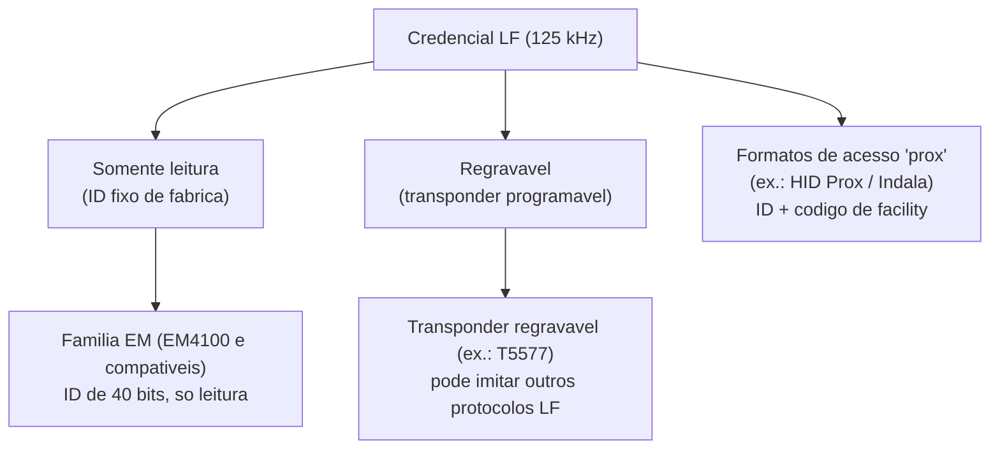
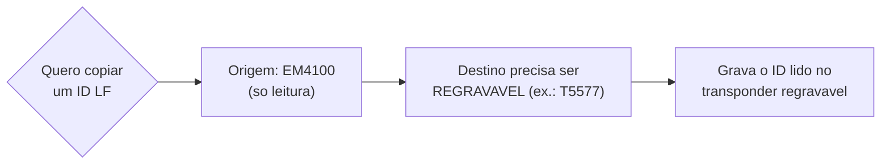

# 03 - Baixa Frequência (LF, cerca de 125 kHz)

A faixa LF (em geral 125 kHz, às vezes 134 kHz) é a mais antiga e simples do RFID
de proximidade. A maioria das credenciais LF carrega apenas um número de
identificação (ID) e pouca ou nenhuma segurança.

## 1. Como reconhecer que algo é LF

- Uma ferramenta não acha nada em HF, mas acha em LF.
- A credencial costuma ter uma bobina de muitas voltas de fio fino, visível contra
  a luz em cartões translúcidos. É diferente da espiral de poucas voltas do HF.
- Em muitos chaveiros LF o próprio número decimal vem impresso no corpo, um número
  comprido tipo 0010795182. Isso é uma pista forte de LF estilo EM, porque esse
  número costuma ser a versão decimal do ID.

A impressão ajuda a suspeitar, mas só a leitura confirma. Existe cartão sem
nenhuma marcação e tag com marcação enganosa.

## 2. Principais famílias de chip LF

### 2.1 Família EM (ex.: EM4100), somente leitura

Guarda um ID de 40 bits gravado de fábrica. Não dá para reescrever o ID de um
EM4100 de verdade. É o ID simples clássico de acesso legado. O número impresso no
chaveiro em geral deriva desse ID.

### 2.2 Transponders regraváveis (ex.: T5577)

São chips programáveis que conseguem se passar por vários protocolos LF, inclusive
emular um EM4100. São a base das tags LF em branco usadas para cópia. Como podem
imitar outros, podem confundir a identificação: um leitor pode reportar EM4100
quando na verdade é um T5577 configurado para imitar um.

### 2.3 Formatos de controle de acesso (prox)

Credenciais de acesso LF mais sérias carregam, além do número do cartão, um código
de instalação (facility) e um formato de bits (wiegand). Aqui o ID não é um número
solto, é um pacote com campos.

## 3. O que dá e o que não dá para fazer

| Chip LF | Ler ID? | Reescrever ID? | Observação |
|---|---|---|---|
| EM4100 (só leitura) | Sim | Não | ID fixo de fábrica |
| T5577 (regravável) | Sim | Sim | Pode emular outros protocolos LF |
| Prox/Indala (acesso) | Sim (o número) | Depende | Tem facility code e formato |

Regra prática 3 (LF): você lê de qualquer um, mas só grava num transponder
regravável. Não existe reescrever o ID de um EM4100 de verdade.

## 4. Segurança da faixa LF

Em geral baixa ou nenhuma. A maioria transmite o ID em claro, sem autenticação.
Por isso credenciais LF só-ID são fáceis de ler, e é também por isso que sistemas
modernos migraram para HF com criptografia (próximo capítulo).

## Resumo do capítulo

- LF fica em torno de 125 kHz, com dados simples, quase sempre só um ID.
- EM4100 é só leitura. Transponders regraváveis (ex.: T5577) aceitam escrita e
  conseguem emular outros protocolos LF.
- Número decimal impresso no corpo é pista, não prova.
- Copiar ID de LF exige um destino regravável.

Próximo: [04 - Alta Frequência (HF)](04-alta-frequencia-hf.md)
