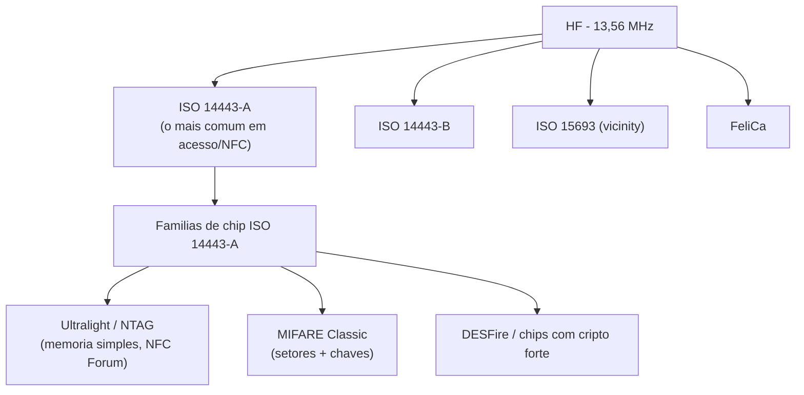
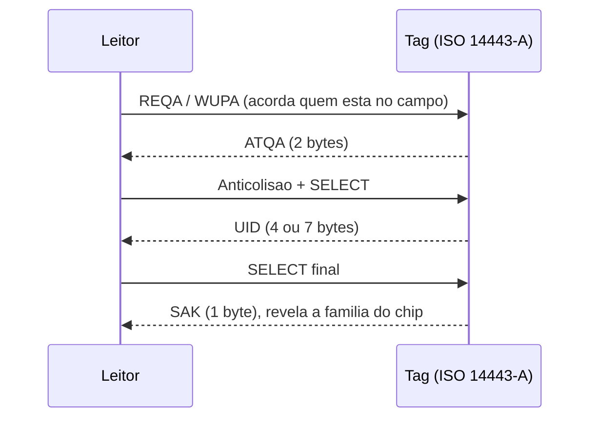
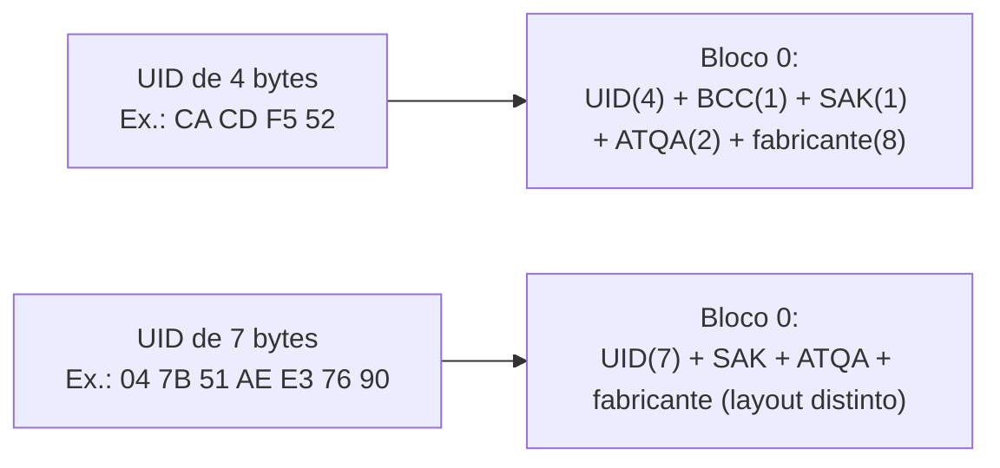

# 04 - Alta Frequência (HF, 13,56 MHz)

A faixa HF opera em 13,56 MHz e é onde está quase tudo que é moderno: crachás
corporativos, bilhetes de transporte, passaportes, pagamento e o NFC do celular.
Diferente do LF, aqui há protocolos bem definidos, memória estruturada e, em
muitos chips, criptografia.

## 1. Como reconhecer que algo é HF

- Uma ferramenta acha a credencial em HF, e não acha em LF.
- A antena interna é uma espiral de poucas voltas, muitas vezes grande e
  retangular, visível contra a luz em cartões translúcidos.
- A leitura devolve campos típicos de HF: UID, ATQA e SAK (explicados adiante). É
  a assinatura de que estamos no mundo ISO 14443.

## 2. Os protocolos de HF

Vários protocolos convivem em 13,56 MHz. O mais comum em credenciais de acesso é o
ISO/IEC 14443 Tipo A. Há também o Tipo B, o ISO 15693 (vicinity, alcance maior),
o FeliCa e outros.

## 3. A identidade de uma tag ISO 14443-A

Ao energizar uma tag Tipo A, o leitor obtém três valores que são o ponto de
partida da identificação:

- UID (Unique Identifier): o número de série da tag. Pode ter 4 bytes (UID curto)
  ou 7 bytes (UID longo). O tamanho importa muito, como veremos.
- ATQA (Answer To reQuest, type A): 2 bytes enviados na resposta ao chamado. Dá
  dicas do tipo e do tamanho do UID.
- SAK (Select AcKnowledge): 1 byte enviado ao final da seleção. É a principal
  pista do tipo de chip.

### 3.1 Lendo o SAK

O SAK é a forma mais rápida de estimar a família. Valores comuns:

| SAK (hex) | Família provável |
|---|---|
| 00 | Ultralight / NTAG (memória simples) |
| 08 | MIFARE Classic 1K |
| 18 | MIFARE Classic 4K |
| 20 | Chip com camada ISO 14443-4 (ex.: DESFire, cripto forte) |

O SAK é pista, não laudo. Chips mágicos e variações podem mostrar SAK igual ao de
um chip comum. Sempre cruze SAK com ATQA, tamanho de UID e comportamento.

### 3.2 UID de 4 ou 7 bytes e por que decide compatibilidade

O tamanho do UID precisa bater quando se quer copiar uma credencial para outra,
porque o primeiro bloco de memória (que guarda o UID) tem layout diferente para 4
e 7 bytes.

Regra prática 4 (HF): copiar uma credencial de UID de 4 bytes para um destino de 7
bytes (ou o contrário) costuma dar erro de tamanho de UID. O tamanho do UID do
destino tem que casar com o da origem.

## 4. As três grandes famílias ISO 14443-A

### 4.1 Ultralight / NTAG, memória simples

SAK em geral 00. Não têm setores nem chaves no estilo Classic. São páginas simples
de memória, padrão NFC Forum. Importante para a identificação: uma credencial
NTAG/Ultralight não consegue guardar um dump de MIFARE Classic, porque a estrutura
e o UID (7 bytes) são diferentes. Confundir os dois é uma fonte clássica de erro.

### 4.2 MIFARE Classic, setores e chaves

SAK 08 (1K) ou 18 (4K). Memória dividida em setores, cada um com duas chaves e
bits de acesso. É o alvo mais comum em controle de acesso. Tem um capítulo só para
ela: [05 - MIFARE Classic](05-mifare-classic.md).

### 4.3 Chips de criptografia forte (ex.: DESFire)

Têm camada ISO 14443-4 (SAK tipo 20) e usam criptografia robusta (3DES/AES) com
autenticação mútua. Na prática, não são clonáveis como um Classic. Aqui a
identificação serve mais para saber que não dá para copiar fácil.

## Resumo do capítulo

- HF é 13,56 MHz, com memória estruturada e, às vezes, criptografia.
- A identidade de uma tag Tipo A sai de UID, ATQA e SAK.
- O SAK é a pista rápida da família. O tamanho do UID (4 ou 7) decide
  compatibilidade de cópia.
- Três famílias: Ultralight/NTAG (simples), MIFARE Classic (setores e chaves) e
  cripto forte (DESFire e afins).

Próximo: [05 - MIFARE Classic por dentro](05-mifare-classic.md)
