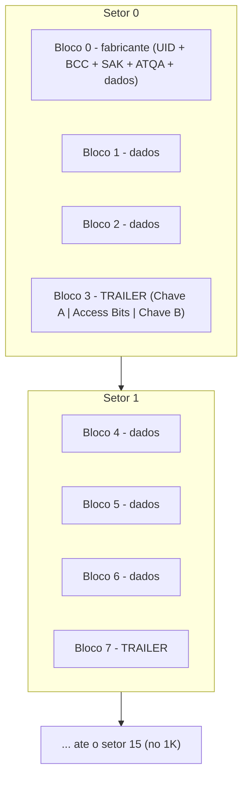
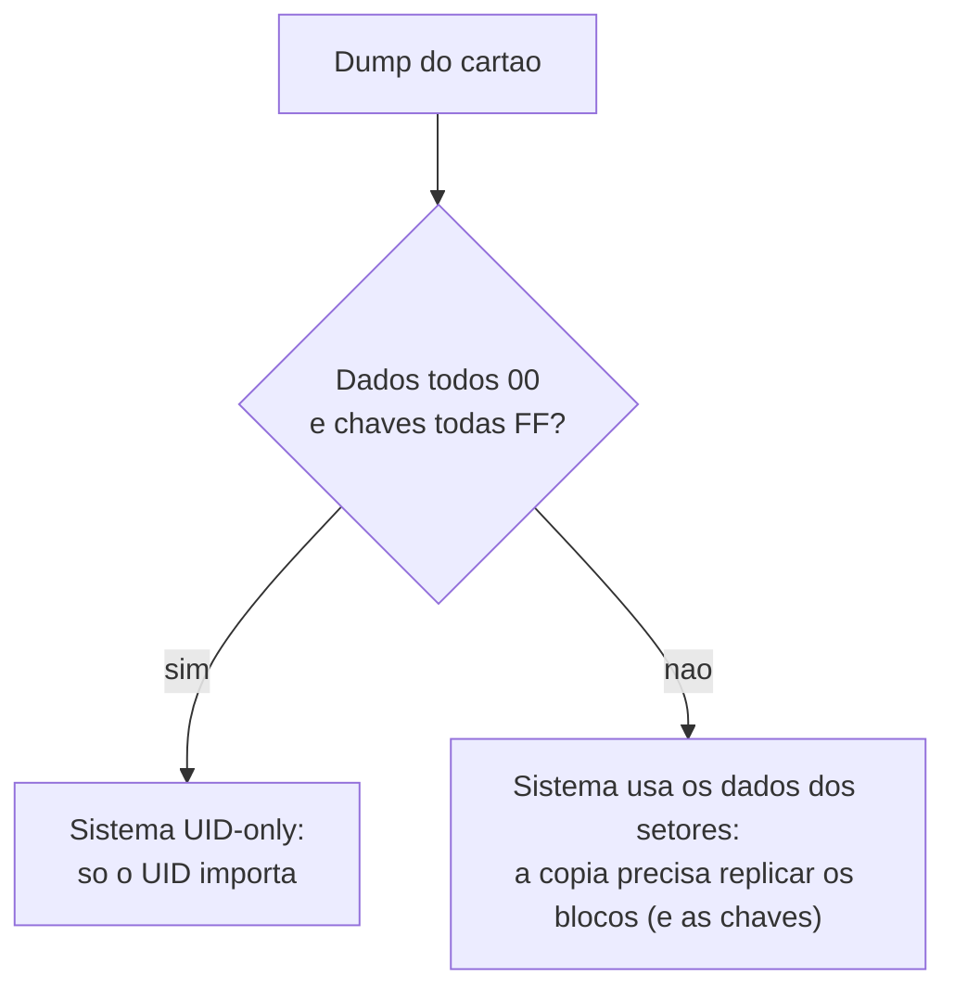

# 05 - MIFARE Classic por dentro

O MIFARE Classic é o chip HF mais comum em controle de acesso. Entender como a
memória dele é organizada é o que permite ler, interpretar um dump e decidir se, e
como, ele pode ser copiado.

## 1. Blocos e setores

A memória do Classic é dividida em blocos de 16 bytes. Os blocos são agrupados em
setores. O tamanho total define a variante:

| Variante | SAK | Setores | Blocos | Tamanho |
|---|---|---|---|---|
| MIFARE Classic Mini | 09 | 5 | 20 | 320 B |
| MIFARE Classic 1K | 08 | 16 | 64 | 1.024 B |
| MIFARE Classic 4K | 18 | 40 | 256 | 4.096 B |

No 1K, o mais comum: 16 setores, cada um com 4 blocos, dando 64 blocos.



## 2. O bloco 0 (fabricante) e o UID

O primeiro bloco do setor 0 é especial: guarda o UID e dados do fabricante. Num 1K
de UID de 4 bytes, o layout é:

```
Bloco 0:  CA CD F5 52 | A0 | 08 | 04 00 | 04 7B 51 AE E3 76 AC 90
          \_ UID (4) _/  BCC  SAK  ATQA   \____ dados fabricante ____/
```

- UID (4 bytes): o número de série.
- BCC: byte de verificação, igual ao XOR dos 4 bytes do UID. Aqui
  CA XOR CD XOR F5 XOR 52 dá A0. Se o BCC não bate, a seleção falha.
- SAK e ATQA: os mesmos valores do capítulo anterior, agora gravados no bloco.

Em cartões comuns, o bloco 0 é travado de fábrica e não regrava. Poder ou não
reescrever o UID é justamente o que separa um cartão comum de um "mágico"
(capítulo 06).

## 3. O trailer de setor: chaves e bits de acesso

O último bloco de cada setor é o trailer e tem um papel crítico:

```
Trailer:  FF FF FF FF FF FF | FF 07 80 69 | FF FF FF FF FF FF
          \___ Chave A (6) __/ \ Access (4)/ \___ Chave B (6) __/
```

- Chave A e Chave B (6 bytes cada): as senhas do setor. Para ler ou escrever os
  blocos daquele setor é preciso autenticar com uma delas.
- Access bits (4 bytes): definem o que cada chave pode fazer em cada bloco (ler,
  escrever, incrementar). É aqui que mora o perigo: bits de acesso errados podem
  travar o setor de vez.

O valor de fábrica mais comum é a chave FF FF FF FF FF FF com access bits
FF 07 80 69, um cartão virgem.


Cuidado importante: ao zerar um Classic, não basta escrever tudo em 00, porque
isso inclui os access bits, e um padrão inválido pode travar o setor. Para
resetar com segurança, grave os trailers com o padrão de fábrica (FF até FF mais
FF 07 80 69).

## 4. Lendo um dump: o caso UID-only

Muitos sistemas de acesso só conferem o UID e ignoram o conteúdo dos setores. Como
reconhecer isso num dump? Quando todos os dados são 00 e todas as chaves são o
padrão FF até FF:

```
Bloco 0:  CA CD F5 52 A0 08 04 00 ...   (unico bloco com informacao real, o UID)
Bloco 1:  00 00 00 00 00 00 00 00 ...   (vazio)
Bloco 3:  FF FF FF FF FF FF FF 07 80 69 FF FF FF FF FF FF   (trailer de fabrica)
...       (o resto do cartao e igual: zeros mais trailers de fabrica)
```

Leitura disso: o cartão não guarda nada além do número de série. O sistema que o
usa libera o acesso só pelo UID.



Regra prática 5: num cartão UID-only, copiar é reproduzir o UID num destino que
aceite gravar o bloco 0. O conteúdo dos outros setores não importa. Já num cartão
que usa os dados, a cópia precisa replicar todos os blocos e conhecer as chaves de
cada setor.

## Resumo do capítulo

- Memória é feita de blocos de 16 bytes agrupados em setores. O 1K tem 16 setores
  e 64 blocos.
- O bloco 0 guarda UID, BCC, SAK e ATQA, e costuma ser travado de fábrica.
- Cada setor tem um trailer com Chave A, Chave B e access bits.
- Access bits errados travam o setor. Resetar exige o padrão de fábrica.
- Dump com tudo em 00 e chaves FF indica sistema UID-only.

Próximo: [06 - Cartões Magic e gerações](06-cartoes-magic.md)
