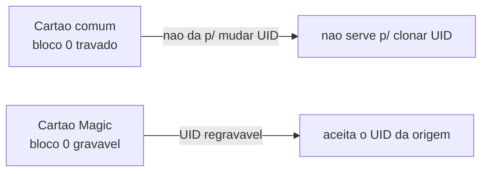
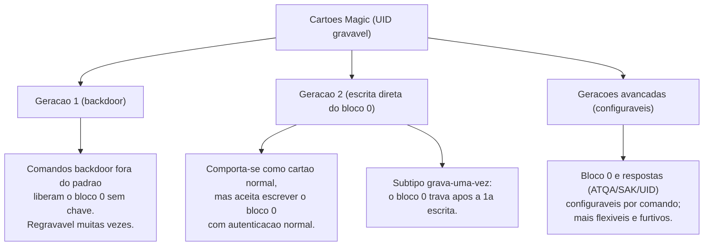
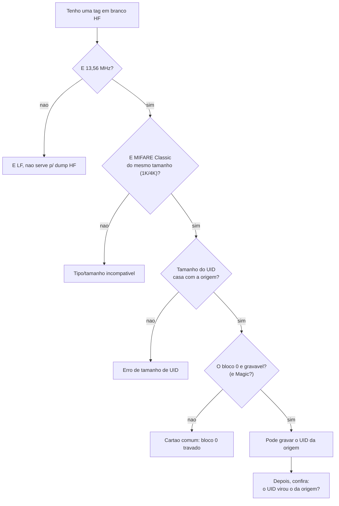

# 06 - Cartões Magic e gerações

Um cartão Magic é uma credencial HF em branco cujo bloco 0 pode ser reescrito, ou
seja, dá para mudar o UID. Cartões comuns têm o bloco 0 travado de fábrica. Os
Magic existem justamente para permitir cópia. Conhecer as gerações é o que evita
gastar e perder tags à toa.

## 1. O problema que o Magic resolve

No [capítulo 05](05-mifare-classic.md) vimos que o bloco 0 (com o UID) é travado
num cartão comum. Então, para copiar uma credencial UID-only, você precisa de um
destino onde o UID seja gravável. Esse destino é o Magic.

## 2. As gerações de Magic

As gerações descrevem como o bloco 0 é liberado para escrita. Os nomes variam
entre fabricantes, mas o conceito agrupa assim:

### 2.1 Geração 1, backdoor

Responde a comandos especiais, fora do padrão, que destravam o bloco 0 sem
precisar de chave. É o tipo mais simples e regravável quantas vezes quiser, bom
para errar e corrigir. Para identificar: responde à sequência de acordar backdoor.
Se responde, é Geração 1.

### 2.2 Geração 2, escrita direta

Do ponto de vista do protocolo, parece um cartão normal. A diferença é que o bloco
0 aceita escrita com o fluxo de autenticação comum, sem backdoor. É mais furtivo
que a Geração 1. Cuidado: existe um subtipo grava-uma-vez em que o bloco 0 trava
depois da primeira gravação. Escrever o UID errado nele significa tag perdida.

### 2.3 Gerações avançadas, configuráveis

Permitem configurar não só o UID, mas também ATQA, SAK e comportamento, por
comandos próprios. São mais versáteis e mais difíceis de detectar.

## 3. Como o UID se relaciona com a geração

Além da geração, o Magic tem um tamanho de UID (4 ou 7 bytes). Para copiar, o
tamanho do destino tem que casar com o da origem (regra 4 do
[capítulo 04](04-alta-frequencia-hf.md)).

| Origem (credencial a copiar) | Destino Magic necessário |
|---|---|
| Classic 1K, UID 4 bytes | Magic 1K, 4 bytes (Geração 1 é o mais simples) |
| Classic 1K, UID 7 bytes | Magic 1K, 7 bytes |
| Classic 4K | Magic 4K (mesmo tamanho de UID da origem) |

## 4. Fluxo de decisão: posso gravar nesta tag?

Regra prática 6: sempre verifique depois de gravar. Releia o destino e confira se
o UID virou mesmo o da origem. Se continuar o UID antigo da tag, o bloco 0 não
aceitou (não é Magic de verdade, ou é grava-uma-vez já gasto).

Por que tags se perdem: escrever o UID errado num Magic grava-uma-vez trava o
bloco 0 para sempre. Para não perder, prefira Geração 1 (regravável) e nunca force
uma gravação quando a ferramenta avisar incompatibilidade.

## Resumo do capítulo

- Magic é uma credencial HF com bloco 0 gravável (UID regravável).
- Geração 1 usa backdoor e regrava sempre, mais segura para aprender. Geração 2
  escreve direto e tem subtipo grava-uma-vez (risco de perda). As avançadas são
  configuráveis.
- O tamanho do UID do destino tem que casar com o da origem.
- Sempre confira o UID depois de gravar.

Próximo: [07 - Metodologia de identificação](07-metodologia-identificacao.md)
