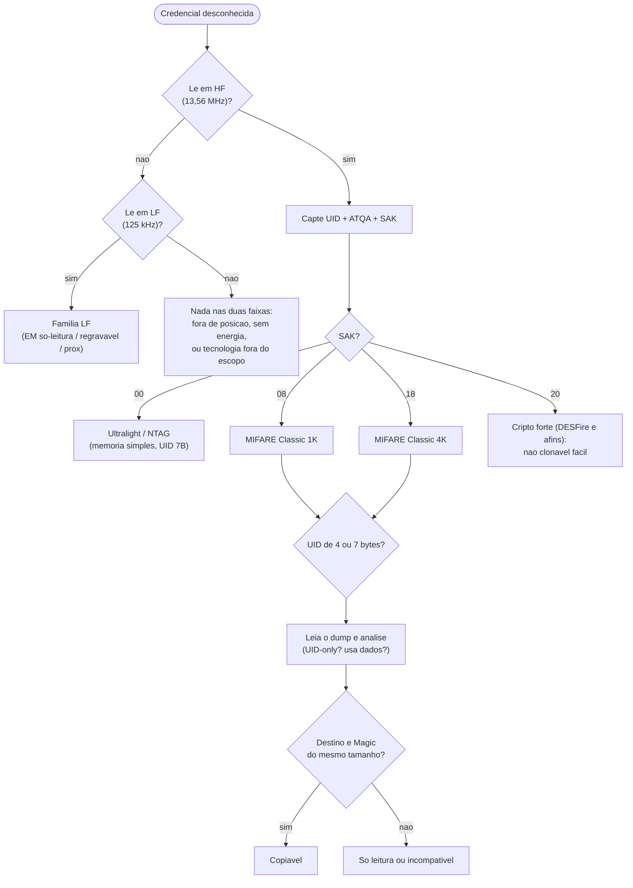

# 07 - Metodologia de identificação (passo a passo)

Este capítulo junta tudo num procedimento prático: dada uma credencial
desconhecida, como chegar com segurança a "o que é isto e o que dá para fazer".

A regra base é descer as camadas em ordem: frequência, protocolo, tipo, memória e
capacidade de escrita.

## 1. O fluxograma mestre

## 2. Passo a passo comentado

### Passo 1 - Descobrir a frequência

Tente HF primeiro, depois LF. Lembre que nada em HF não quer dizer credencial
morta, teste LF antes de desistir. E nada nas duas quase sempre é posição (regra
2): varie o lugar sobre a antena, as duas faces e a inclinação.

### Passo 2 - Captar a identidade (no caso HF)

Obtenha UID, ATQA e SAK. Anote o tamanho do UID (4 ou 7 bytes), porque ele decide
compatibilidade de cópia.

### Passo 3 - Classificar a família pelo SAK

Use a tabela do [capítulo 04](04-alta-frequencia-hf.md) como pista: 00 é NTAG, 08
é Classic 1K, 18 é Classic 4K, 20 é cripto forte. Confirme cruzando com ATQA e
comportamento.

### Passo 4 - Ler o dump e entender o uso

Se for Classic, leia o conteúdo. Pergunte:

- É UID-only? (tudo em 00 e chaves FF) Então só o UID importa.
- Usa os dados? Então a cópia precisa replicar blocos e conhecer as chaves.

### Passo 5 - Avaliar o destino (se o objetivo é copiar)

O destino precisa ser da mesma família, mesmo tamanho (1K ou 4K) e mesmo tamanho
de UID. E precisa ter o bloco 0 gravável (ser Magic) se o UID precisar mudar.

### Passo 6 - Gravar e verificar

Depois de gravar, releia e confirme que o UID virou o esperado (regra 6).
Verificar não é opcional, é a diferença entre "achei que copiei" e "copiei".

## 3. Tabela-resumo de decisão

| Sinal observado | Conclusão provável | Ação |
|---|---|---|
| Só LF encontra | Credencial de 125 kHz | Tratar como LF (cap. 03) |
| HF, SAK 00 | Ultralight/NTAG (UID 7B) | Não guarda dump de Classic |
| HF, SAK 08 | Classic 1K | Ler dump, checar UID-only |
| HF, SAK 18 | Classic 4K | Idem, destino 4K |
| HF, SAK 20 | Cripto forte | Não clonável fácil |
| Dump tudo 00 e chaves FF | Sistema UID-only | Copiar só o UID |
| Nada em HF nem LF | Posição ou energia | Reposicionar e repetir |
| Gravou mas UID não mudou | Bloco 0 travado, não-Magic | Trocar de destino |

## 4. Checklist rápido

- Testei HF e LF?
- Variei a posição antes de desistir?
- Anotei UID (e o tamanho), ATQA e SAK?
- Se Classic: li o dump e vi se é UID-only?
- O destino casa em família, tamanho e tamanho de UID?
- O destino é Magic, se eu precisar mudar o UID?
- Verifiquei relendo o destino depois de gravar?

## Resumo do capítulo

- Identificar é descer camadas em ordem, com o fluxograma mestre como mapa.
- HF e LF sempre, e posição antes de desistir.
- A decisão de copiar depende de família, tamanho, tamanho de UID e de ser Magic.
- Verificar depois de gravar faz parte do método.

Próximo: [08 - Erros comuns e soluções](08-erros-comuns.md)
