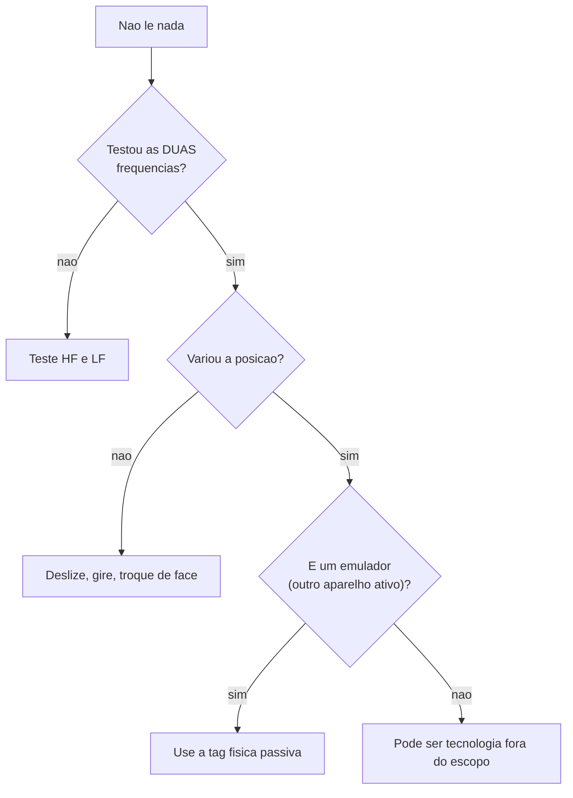
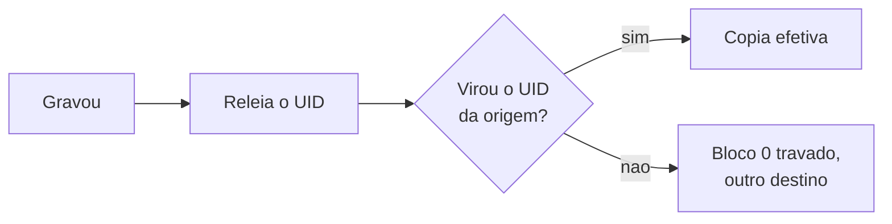

# 08 - Erros comuns e como resolver

Lista dos tropeços mais frequentes na leitura, identificação e cópia, com o
porquê de cada um e a saída. A maioria não é defeito de equipamento, é camada
errada, posição ruim ou destino incompatível.

## 1. "Não lê nada"

Sintoma: a ferramenta não detecta a credencial.

Causas e saídas:
- Frequência errada: teste HF e LF (regra 1).
- Posição: varie o lugar sobre a antena (regra 2). A maioria das não-leituras some
  aqui.
- Lendo um emulador com outro leitor: troque pela tag física.

## 2. "UID size mismatch", tamanho de UID

Sintoma: a ferramenta recusa a gravação citando tamanho de UID.

Causa: origem e destino têm tamanhos de UID diferentes (4 e 7 bytes). O bloco 0
tem layout distinto para cada tamanho.

Saída: use um destino Magic com o mesmo tamanho de UID da origem. Um dump de 4
bytes precisa de um Magic de 4 bytes (regra 4).

## 3. "Block count mismatch", número de blocos

Sintoma: erro citando contagem de blocos ou setores.

Causa: tentar gravar um dump de uma variante em outra, por exemplo um dump de 1K
(64 blocos) num cartão 4K (256 blocos) ou Mini (20 blocos).

Saída: destino da mesma variante da origem (1K para 1K, 4K para 4K).

## 4. "Gravou, mas o UID não mudou"

Sintoma: a gravação é aceita, mas relendo, o UID continua o antigo da tag.

Causa: o bloco 0 está travado. O cartão não é Magic de verdade, ou é um
grava-uma-vez já gasto.

Saída: trocar de destino por um Magic com bloco 0 regravável (Geração 1 é o mais
seguro). Sempre releia para confirmar (regra 6).

## 5. "Perdi a tag" (brick)

Sintoma: a tag parou de aceitar escrita ou ficou inutilizável.

Causas comuns:
- Escrever o UID errado num Magic grava-uma-vez, que trava com valor errado.
- Escrever access bits inválidos num trailer (ao zerar com tudo em 00), que trava
  o setor.

Prevenção:
- Prefira Magic Geração 1 (regravável) para aprender e testar.
- Nunca force uma gravação quando a ferramenta avisar incompatibilidade.
- Ao resetar, grave trailers com o padrão de fábrica (FF até FF mais access bits
  válidos), nunca tudo em 00.

## 6. "Usei a função errada do equipamento"

Sintoma: a ferramenta manda usar o cartão de origem ou ir para o modo de gravar em
branco.

Causa: existe diferença entre reescrever a credencial original e gravar numa tag
em branco ou Magic. São funções diferentes.

Saída: use o modo de escrita em cartão Magic ou em branco, não a função que
regrava o original.

## 7. "A ferramenta diz EM4100, mas o comportamento é estranho"

Sintoma: a leitura LF reporta um tipo, mas a cópia ou escrita se comporta
diferente.

Causa: um transponder regravável pode estar emulando o protocolo reportado. O
rótulo lido pode não refletir o chip real.

Saída: considere que LF regravável imita outros. Valide testando escrita e
releitura.

## Tabela-relâmpago

| Mensagem ou sintoma | Causa provável | Saída |
|---|---|---|
| Não lê nada | Frequência, posição ou emulador | Testar HF e LF, reposicionar, usar tag física |
| UID size mismatch | 4 e 7 bytes | Destino com mesmo tamanho de UID |
| Block count mismatch | 1K, 4K ou Mini | Destino da mesma variante |
| Gravou, UID não mudou | Bloco 0 travado, não-Magic | Outro destino Magic, reler |
| Tag parou de funcionar | Write-once errado ou access bits inválidos | Geração 1, nunca forçar, trailer de fábrica |
| "Use o cartão de origem" | Função errada | Usar o modo de gravar em branco ou Magic |

## Resumo do capítulo

- Quase todo erro cai em: camada errada, posição, tamanho ou variante
  incompatível, bloco 0 travado, ou modo errado.
- Forçar gravação e zerar com tudo em 00 são as duas maiores causas de tag
  perdida.
- Reler depois de gravar resolve metade das dúvidas.

Próximo: [09 - Estudo de caso](09-estudo-de-caso.md)
