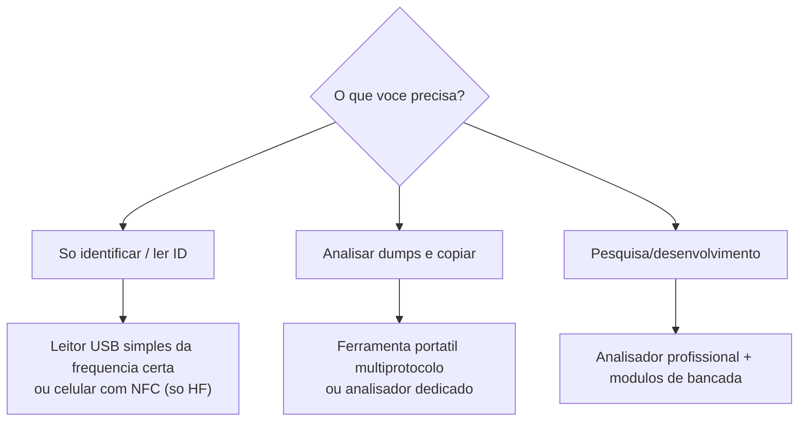

# 09 - Dispositivos de leitura (apêndice)

Até aqui o guia foi neutro quanto a equipamento, de propósito, para focar nos
conceitos. Este apêndice cita categorias e exemplos de aparelhos que ajudam a ler
e identificar credenciais RFID, para quem quer colocar a mão na massa.

A escolha depende de quais frequências você precisa, do nível de controle que quer
e do orçamento. Uma boa regra: para só identificar, quase qualquer leitor da
frequência certa serve. Para analisar e copiar, vale um equipamento
multifrequência com bom software.

## 1. Para HF (13,56 MHz)

- Celular com NFC: o leitor HF mais acessível que existe. Com apps de leitura NFC
  dá para capturar UID, ATQA e SAK e identificar a família na hora, um ótimo
  primeiro filtro. Não serve para LF.
- Leitores USB NFC (ex.: ACR122U e similares PC/SC): leitores de mesa HF, bons
  para automação via computador. Úteis para ler e identificar em lote.
- Módulos embarcados (ex.: PN532, RC522): placas baratas para projetos DIY com
  Arduino ou Raspberry Pi. Boas para aprender o protocolo e montar seu próprio
  leitor HF.

## 2. Para LF (125 kHz)

- Leitores USB LF dedicados: aparelhos simples que entregam o ID de tags LF (estilo
  EM). Como o celular não lê LF, um leitor LF é indispensável para essa faixa.
- Módulos LF (ex.: RDM6300 e afins): equivalentes DIY para 125 kHz.

## 3. Multifrequência e portáteis tudo em um

Aparelhos que cobrem LF e HF no mesmo dispositivo e trazem software para
identificar, salvar dumps e, quando permitido, copiar:

- Proxmark3 (e variantes como a RDV4): a referência em análise RFID.
  Multifrequência, muito poderosa e com forte apoio da comunidade. Curva de
  aprendizado maior, controle total.
- Flipper Zero: portátil multiuso com LF e HF integrados, interface amigável e app
  próprio para leitura, identificação e cópia. Bom para o dia a dia.
- Chameleon (linha Ultra e Mini): focada em HF, forte em emulação de credenciais e
  também capaz de leitura nos modelos com leitor.

Como escolher:
- Só quer saber o que é uma credencial HF? O celular com NFC resolve.
- Precisa de LF também? Um leitor LF ou um portátil multifrequência.
- Quer analisar a fundo ou pesquisar? Proxmark3.
- Quer praticidade portátil com as duas faixas? Flipper Zero.
- Foco em emular HF? Chameleon.

## 4. Boas práticas com qualquer aparelho

- Comece pelo mais simples (celular ou leitor da frequência certa) antes de partir
  para ferramentas avançadas.
- Posicione bem (regra 2): centralize a credencial sobre a antena.
- Salve os dumps com nomes claros e fora do controle de versão, por serem dados
  sensíveis. Veja o .gitignore deste repositório.
- Verifique depois de gravar (regra 6), sempre.

## Encerramento

Com os capítulos 01 a 08 você entende o que é cada credencial e como identificá-la.
Com este apêndice, com o que fazer isso. O método importa mais que o aparelho:
frequência, protocolo, tipo, memória e escrita, sempre verificando no final.

Voltar ao [índice (README)](../README.md)
