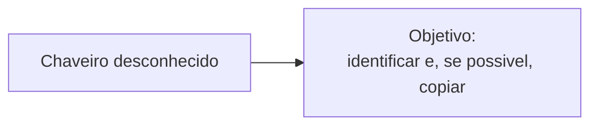
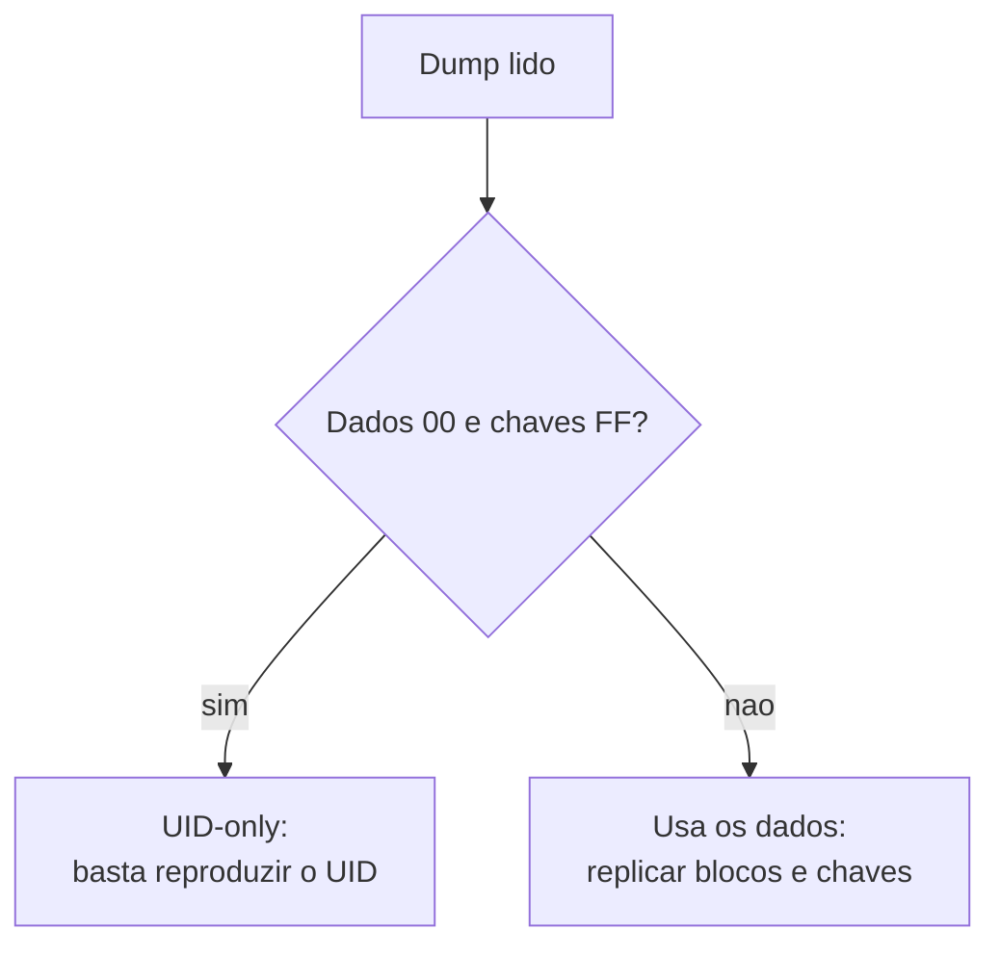
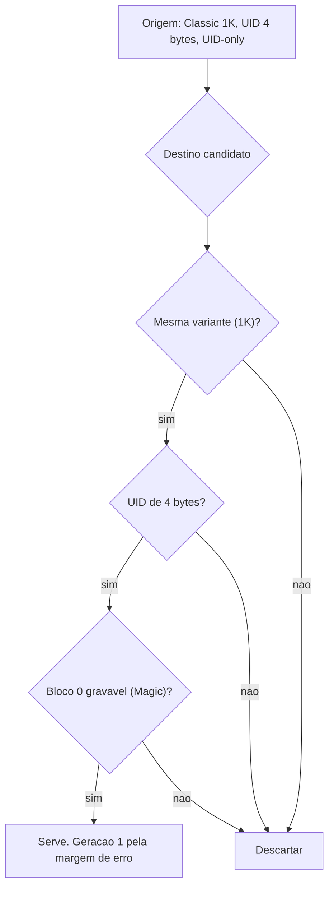
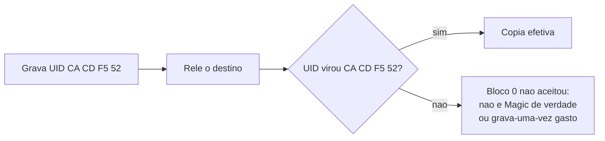

# 09 - Estudo de caso: do desconhecido ao identificado

Os capítulos anteriores montaram as peças. Aqui elas entram em ação num exemplo
completo, decisão por decisão, do jeito que acontece na prática. A ideia é ver o
método do [capítulo 07](07-metodologia-identificacao.md) rodando de ponta a ponta.

O caso é ilustrativo e os valores são de exemplo. O objetivo é copiar uma
credencial para um destino em branco, com autorização do dono (veja
[uso responsável](../README.md)).

## O ponto de partida

Chega um chaveiro sem marcação nenhuma. Não dá para saber nada pela aparência
(regra do [capítulo 02](02-anatomia-interna.md): formato não é função). Tudo o que
sabemos é o objetivo: descobrir o que é e, se der, fazer uma cópia funcional.



## Passo 1: qual frequência?

Primeiro teste em HF (13,56 MHz). A credencial responde. Se não respondesse, o
próximo teste seria LF (125 kHz) antes de concluir qualquer coisa, porque as duas
faixas não se enxergam (regra 1).

Resultado: responde em HF. Já descartamos a faixa LF e todo o mundo EM4100 e
companhia.

## Passo 2: captar a identidade

Em HF do tipo ISO 14443-A, a leitura entrega três valores. No nosso caso:

```
UID:  CA CD F5 52   (4 bytes)
ATQA: 00 04
SAK:  08
```

Duas coisas já saltam: o UID tem 4 bytes (UID curto) e o SAK é 08.

## Passo 3: classificar pelo SAK

Consultando a tabela do [capítulo 04](04-alta-frequencia-hf.md):

| SAK | Família |
|---|---|
| 00 | Ultralight / NTAG |
| 08 | MIFARE Classic 1K |
| 18 | MIFARE Classic 4K |
| 20 | Cripto forte |

SAK 08 aponta para MIFARE Classic 1K. O ATQA 00 04 é coerente com isso. O SAK é
pista, não laudo, então confirmamos cruzando com o comportamento no próximo passo,
ao ler a memória.

## Passo 4: ler o dump e entender o uso

Lendo o conteúdo do Classic 1K, o que aparece é:

```
Bloco 0:  CA CD F5 52 A0 08 04 00 ...   (UID + BCC + SAK + ATQA + fabricante)
Bloco 1:  00 00 00 00 00 00 00 00 ...   (zeros)
Bloco 2:  00 00 00 00 00 00 00 00 ...   (zeros)
Bloco 3:  FF FF FF FF FF FF FF 07 80 69 FF FF FF FF FF FF   (trailer de fabrica)
...       (o resto do cartao segue igual: zeros mais trailers de fabrica)
```

O BCC bate: CA XOR CD XOR F5 XOR 52 dá A0, o segundo byte do bloco 0. A seleção é
válida.

A leitura do dump responde a pergunta que decide tudo: todos os dados estão em 00 e
todas as chaves são o padrão FF. Isto é um sistema UID-only
([capítulo 05](05-mifare-classic.md)). O cartão não guarda nada além do número de
série, e quem o usa libera o acesso só pelo UID.



Conclusão parcial: para copiar, basta reproduzir o UID num destino que aceite
gravar o bloco 0. O conteúdo dos outros setores não importa.

## Passo 5: escolher o destino

A origem é um Classic 1K com UID de 4 bytes. Pelas regras dos capítulos
[04](04-alta-frequencia-hf.md) e [06](06-cartoes-magic.md), o destino precisa ser:

- da mesma variante: Classic 1K;
- do mesmo tamanho de UID: 4 bytes;
- com o bloco 0 gravável, ou seja, um cartão Magic.

Para aprender e ter margem de erro, a escolha recai num Magic de Geração 1
(backdoor), que regrava quantas vezes for preciso. Um Magic grava-uma-vez serviria,
mas travaria no primeiro erro, então fica de fora aqui.



## Passo 6: gravar e verificar

Grava-se o UID da origem (CA CD F5 52) no bloco 0 do destino Magic. Em seguida, o
passo que não é opcional: reler o destino e conferir.



Relendo, o UID do destino agora é CA CD F5 52. A cópia funcionou. Como o sistema
de origem é UID-only, esse destino passa a ser aceito no mesmo lugar que o
original.

## E se fosse diferente?

O mesmo método leva a outras conclusões quando os sinais mudam:

| Sinal diferente | Conclusão |
|---|---|
| Não responde em HF, só em LF | Credencial de 125 kHz. Trata-se como LF ([cap. 03](03-baixa-frequencia-lf.md)) |
| SAK 00 | Ultralight / NTAG, UID de 7 bytes. Não guarda dump de Classic |
| SAK 20 | Cripto forte. Não clonável como um Classic |
| UID de 7 bytes | Destino também precisa ser de 7 bytes, senão dá erro de tamanho |
| Dump com dados e chaves não-FF | O sistema usa os setores. A cópia precisa replicar blocos e conhecer as chaves |
| Gravou mas o UID não mudou | Bloco 0 travado. Trocar por um Magic de verdade ([cap. 08](08-erros-comuns.md)) |

## O que esse caso mostra

- O caminho é sempre o mesmo: frequência, identidade (UID/ATQA/SAK), família,
  dump, destino, gravação e verificação.
- Cada passo elimina possibilidades. Ao chegar na gravação, já se sabe exatamente
  o que fazer e por quê.
- A verificação final é o que separa "achei que copiei" de "copiei".

## Resumo do capítulo

- Um caso real de identificação é só o método do capítulo 07 aplicado com calma.
- SAK 08 mais dump com tudo 00 e chaves FF é a assinatura de um Classic 1K
  UID-only, o cenário mais simples de copiar.
- Destino tem que casar em variante, tamanho de UID e ser Magic.
- Mudando os sinais, o mesmo caminho leva a outras conclusões, inclusive a de que
  não dá para copiar.

Próximo: [10 - Dispositivos de leitura](10-dispositivos-leitura.md)
